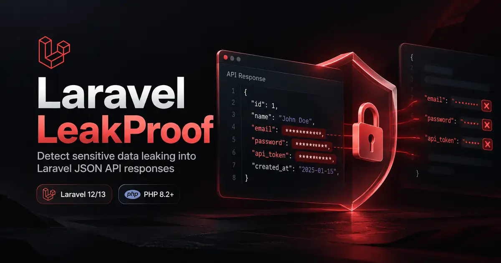

<p align="center">
  
</p>

<h1 align="center">Laravel LeakProof</h1>
<p align="center"><strong>Catch sensitive fields in real Laravel JSON API responses before deployment.</strong></p>

<p align="center">
  <a href="https://github.com/mykholy/laravel-leakproof/actions/workflows/tests.yml"></a>
  <a href="https://packagist.org/packages/mykholy/laravel-leakproof"></a>
  <a href="https://packagist.org/packages/mykholy/laravel-leakproof"></a>
  <a href="LICENSE"></a>
</p>

<p align="center">
  <a href="#quick-start">Quick start</a> ·
  <a href="#what-it-detects">Detection rules</a> ·
  <a href="#fixture-scanning">CLI scanner</a> ·
  <a href="docs/DEVELOPER_GUIDE.md">Developer guide</a> ·
  <a href="#optional-staging-middleware">HTTP middleware</a> ·
  <a href="https://packagist.org/packages/mykholy/laravel-leakproof">Packagist</a>
</p>

**Laravel LeakProof** is a lightweight Laravel security testing package for spotting accidentally exposed sensitive fields in serialized **JSON API responses**. It inspects the actual response your tests receive, including nested arrays and Laravel API Resources. Built-in detection now covers selected **AI API key** formats from OpenAI, Anthropic, Gemini/Google, Hugging Face, Groq, Replicate, Pinecone, Perplexity, OpenRouter, NVIDIA NGC, and Tavily, plus provider-specific sensitive field names.

A passing endpoint test does not necessarily mean its response is safe: changes in serialization may accidentally expose password hashes, API tokens, client secrets or recovery codes. LeakProof reports the **JSON path and detection rule**, not the credential value.

> **Scope:** LeakProof detects selected sensitive key names and high-confidence secret patterns. It is not an authorization system, a static scanner, a response sanitizer, or a substitute for Laravel policies and model `$hidden`.

## AI API key scanning

Catch leaked **OpenAI API keys**, **Anthropic API keys**, **Google/Gemini API keys**, **Hugging Face tokens**, **Groq keys**, and other recognizable secrets inside API response strings. Named fields such as `azureOpenaiApiKey`, `cohereApiKey`, `mistralApiKey`, `deepseekApiKey`, and `openrouterApiKey` are detected even when their value format has no safe signature.

Detection never contacts AI providers and never logs a matched credential. For provider support, rule IDs, exclusions, limitations, and configuration see **[AI API key detection guide](docs/AI-SECRET-DETECTION.md)**.

```php
// This nested JSON response would fail assertNoSensitiveData():
// { "data": { "settings": { "openaiApiKey": "synthetic-example" } } }
$this->assertNoSensitiveData($this->getJson('/api/ai/settings'));
```

## What it detects

| Detection | Example | Result |
| --- | --- | --- |
| Sensitive JSON keys | `password`, `passwordHash`, `api_key`, `access_token` | Fails the assertion, showing the redacted field path |
| Nested response fields | `data.users[0].password` | Reports the nested location |
| Selected secret formats | Private-key headers, recognized live credential prefixes | Flags the matched rule without exposing the value |
| Unexpectedly large/deep responses | Configured inspection limits exceeded | Marks inspection incomplete rather than passing |
| Intentional login tokens | An explicitly allowed `data.access_token` | Supports exact, reviewed path exceptions |

Inspection is **opt-in**: use the test assertion, scan a local JSON fixture, or explicitly add the middleware to selected routes. Middleware is off by default.

## Requirements

PHP 8.2+, Laravel 12 / 13. Laravel 13 itself requires PHP 8.3+.

## Quick start

```bash
composer require --dev mykholy/laravel-leakproof
php artisan vendor:publish --tag=leakproof-config
```

No migrations, tables, scheduled jobs, or external services are required. Auto-discovery registers the provider.

`--dev` is recommended for feature-test assertions. If you intentionally enable the middleware in a deployed environment, install without `--dev` so the package is present there.

### Assert against your real API response

```php
use Mykholy\LeakProof\Testing\Concerns\AssertsNoSensitiveData;

class UserApiTest extends TestCase
{
    use AssertsNoSensitiveData;

    public function test_profile_does_not_leak_secrets(): void
    {
        $response = $this->getJson('/api/me');
        $response->assertOk();
        $this->assertNoSensitiveData($response);
    }
}
```

An accidental `password` response field generates a failure such as `$.data.user.password [field.sensitive_key]`. The field's **value is not included** in diagnostics. This makes the assertion suitable for protecting API contracts in PHPUnit and continuous integration.

### Narrow exceptions for intentional tokens

```php
$this->assertNoSensitiveData($response, ['data.access_token']);
$this->assertNoSensitiveData($response, ['data.sessions.*.access_token']);
```

The wildcard matches **one** segment. Paths are exact: an allow rule exempts only the selected subtree. Never use broad exceptions to silence security failures.

## Fixture scanning

Run these commands **inside your Laravel application**. The scanner accepts a local JSON file; create an illustrative fixture first:

```bash
printf '%s\n' '{"data":{"user":{"name":"Example User","password":"example-only"}}}' > leakproof-sample.json
php artisan leakproof:scan leakproof-sample.json
php artisan leakproof:scan leakproof-sample.json --format=json
```

Both scans should report `$.data.user.password` and return exit code **1**, intentionally failing CI. The test value is synthetic; don't use real credentials in fixtures. For a clean example:

```bash
printf '%s\n' '{"data":{"user":{"name":"Example User"}}}' > leakproof-safe.json
php artisan leakproof:scan leakproof-safe.json
```

The safe example returns exit code **0**. You can explicitly allow a reviewed field with `--allow=data.access_token` when scanning an intentional login response.

Exit codes: 0 clean; 1 finding or incomplete traversal; 2 invalid/unreadable input. The scanner reads local files only. JSON output contains sanitized paths and rules, never original values.

## Optional staging middleware

```php
Route::middleware('leakproof')->get('/profile', ProfileController::class)->name('profile');
```

The middleware is **off** unless explicitly attached **and** enabled:

- `LEAKPROOF_MODE=off` (default): no inspection.
- `LEAKPROOF_MODE=report`: record sanitized paths in application logs.
- `LEAKPROOF_MODE=block`: throw when a response leaks or cannot be fully inspected.

Do not use blocking mode in production without staging tests; legitimate token endpoints may otherwise return 500 errors.

For named routes, configure an exact exception in `config/leakproof.php`:

```php
'allowed_paths' => ['login' => ['data.access_token']],
```

Only JSON responses are inspected. Streams, HTML, and downloads are skipped.

## Programmatic API

```php
use Mykholy\LeakProof\LeakProof;

$report = app(LeakProof::class)->inspect(['user' => ['passwordHash' => 'sensitive']]);

if (! $report->passed()) {
    logger()->warning($report->summary());
}
```

## Safety limits

- Bounded traversal: default max depth 32, 50,000 nodes, and 100 findings.
- JSON input limit: default 2 MiB.
- Exceeding limits makes an inspection **inconclusive**, not successful.
- Only known structural/credential names are displayed in diagnostic paths; all other object keys are replaced by `"<dynamic-key>"` to avoid exposing identifiers or personal information.
- High-confidence value patterns include major AI-provider API keys, private-key headers, and selected live credential prefixes. Configure a subset with `value_rules` (see the AI detection guide).
- This does **not** prove an API is private. Unknown secret formats, encoded values, and authorization mistakes may be missed.
- Personal information such as emails, phone numbers, IDs or addresses is **not automatically treated as a secret**; enforce authorization and data minimization separately.

See the [Security policy](SECURITY.md) and [Security considerations](docs/SECURITY.md).

## Development

```bash
composer install
composer test
composer analyse
composer format-check
composer smoke
```

CI validates supported PHP/Laravel combinations and runs a fresh Laravel application installation smoke test. Use `composer benchmark` for synthetic local performance measurements. See [Contributing](CONTRIBUTING.md), [Security policy](SECURITY.md), [Changelog](CHANGELOG.md), and [GitHub Issues](https://github.com/mykholy/laravel-leakproof/issues).

## License

MIT. Copyright Ahmed Elkholy.
